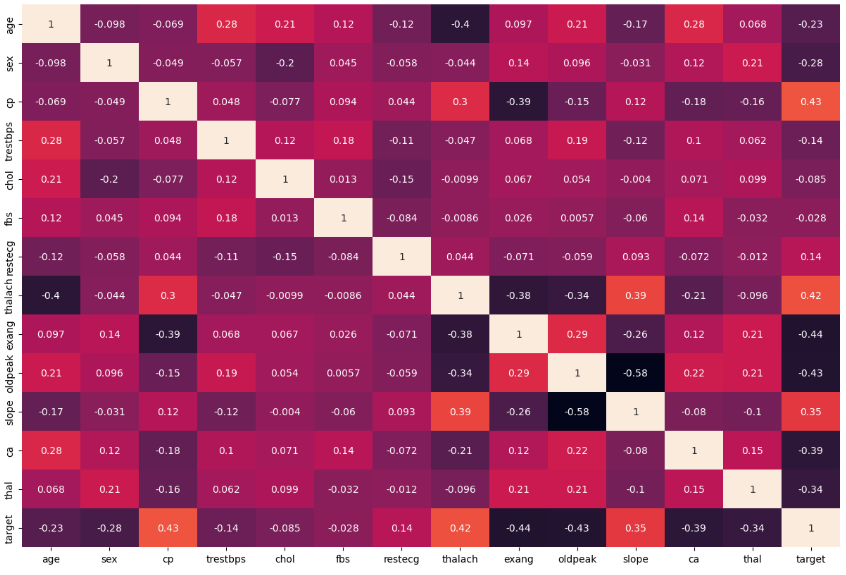
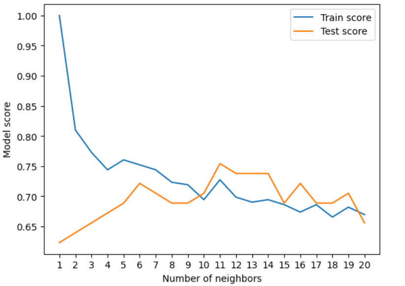
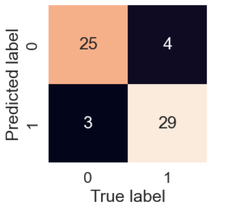
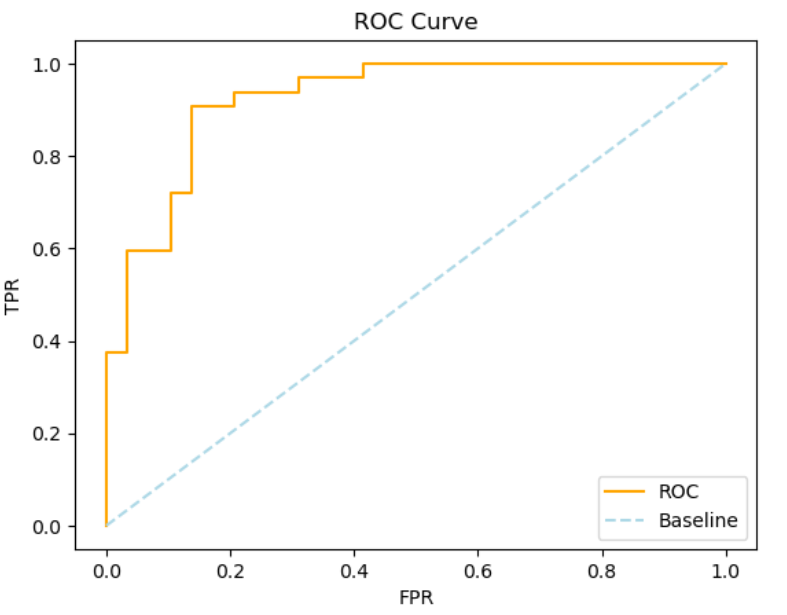

# Heart Disease Prediction Using Machine Learning

## Project Overview

This project focuses on developing a machine learning-based system for predicting whether a patient is likely to have heart disease. The prediction is performed using various medical and clinical attributes, including age, gender, blood pressure, cholesterol levels, heart rate, and other cardiovascular indicators. The objective is to explore supervised learning techniques for supporting early identification and assessment of potential heart-related conditions.

---

## Dataset

The dataset contains several patient-related clinical features used as inputs for classification:

| Feature | Description |
|----------|-------------|
| age | Age of the individual |
| sex | Gender of the patient (1 = male, 0 = female) |
| cp | Type of chest pain experienced |
| trestbps | Resting blood pressure |
| chol | Serum cholesterol level in mg/dl |
| fbs | Indicates whether fasting blood sugar exceeds 120 mg/dl |
| restecg | Results of the resting electrocardiogram |
| thalach | Highest heart rate recorded |
| exang | Indicates exercise-induced angina |
| oldpeak | ST-segment depression caused by exercise |
| slope | Slope of the peak exercise ST segment |
| ca | Number of major vessels observed |
| thal | Thalassemia-related measurement |
| target | Prediction label (1 = heart disease, 0 = no heart disease) |

---

## Methodology

### 1. Data Preprocessing

The raw dataset was prepared before training the machine learning models. The preprocessing stage included:

- Identifying and handling missing or incomplete values
- Converting categorical attributes into suitable numerical representations
- Applying feature scaling where required
- Preparing the dataset for model training and evaluation

### 2. Exploratory Data Analysis

Exploratory analysis was performed to understand the relationships between different clinical attributes. Correlation analysis and visualizations were used to identify patterns and determine how strongly individual features were associated with one another.

**Correlation Matrix:**



---

### 3. Model Development

Three supervised classification algorithms were implemented and evaluated:

1. **Logistic Regression**
2. **K-Nearest Neighbors (KNN)**
3. **Random Forest Classifier**

The models were trained using the processed dataset and their parameters were optimized to improve classification performance.

**KNN Model Visualization:**



---

### 4. Model Evaluation

The trained models were assessed using different performance evaluation techniques. These included confusion matrix analysis and ROC curve visualization to examine classification behavior and the ability of the models to distinguish between patients with and without heart disease.

**Confusion Matrix:**



**ROC Curve:**



---

## Results

The performance obtained after hyperparameter optimization is summarized below:

| Model | Accuracy |
|--------|----------|
| K-Nearest Neighbors | 75.41% |
| Logistic Regression | 88.52% |
| Random Forest | 86.88% |

Among the three approaches, **Logistic Regression produced the best accuracy of 88.52%**, indicating that it provided the strongest classification performance on the evaluated dataset.

---

## Installation and Execution

### 1. Clone the Repository

```bash
git clone https://github.com/AShr12xz/Heart_Disease_Classification_Project.git
cd Heart_Disease_Classification_Project
```

### 2. Install Required Libraries

Install the Python packages required for running the project:

```bash
pip install pandas numpy scikit-learn matplotlib seaborn
```

### 3. Run the Project

Open and execute the `Heart_Disease.ipynb` notebook using Jupyter Notebook or another compatible environment.

---

## Technologies and Tools

| Category | Technologies |
|----------|--------------|
| Programming Language | Python 3.8+ |
| Data Processing | pandas, NumPy |
| Visualization | Matplotlib, Seaborn |
| Machine Learning | Scikit-learn |
| Development Environment | Jupyter Notebook |